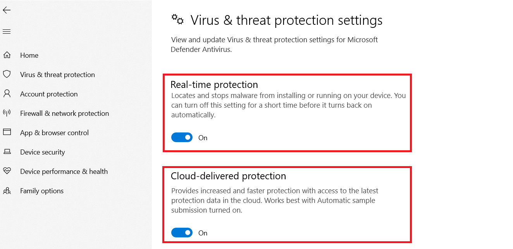
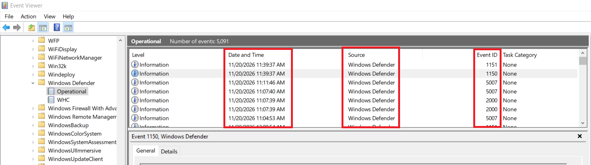
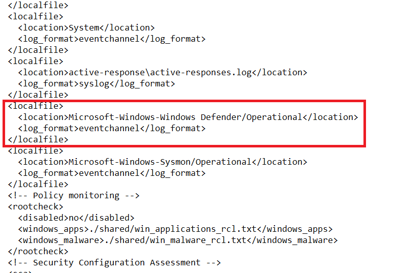
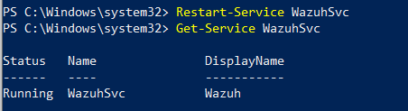
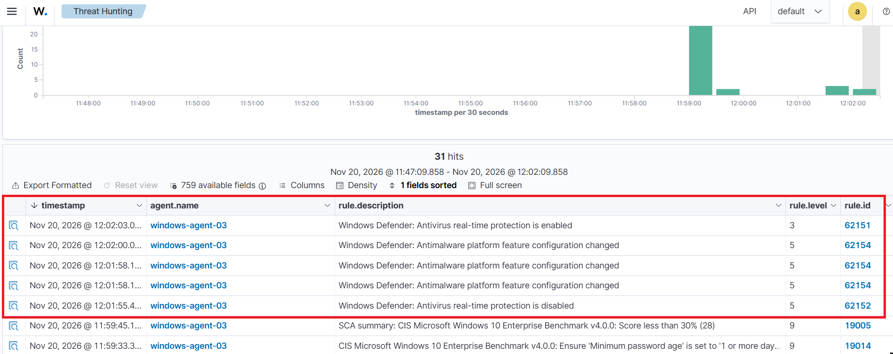
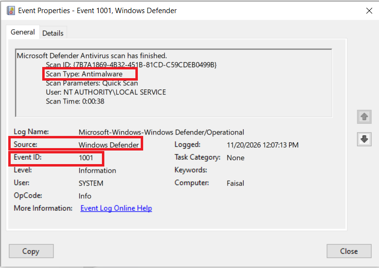

# Windows Defender Logs Integration with Wazuh

**Portfolio Project | Windows Endpoint Security Monitoring**

Integrate Microsoft Windows Defender Operational logs with Wazuh SIEM to collect, monitor, and investigate endpoint security events through a centralized security monitoring platform.

---

## 1. Project Overview

### Objective

Configure the Wazuh Windows Agent to collect Microsoft Windows Defender Operational event logs and forward them to the Wazuh Manager for centralized security monitoring and investigation.

### Key Objectives

- Integrate Windows Defender logs with Wazuh SIEM.
- Monitor endpoint security activities.
- Collect and analyze Defender Operational events.
- Investigate Windows security events through the Wazuh Dashboard.
- Improve endpoint threat visibility.

## 2. Lab Environment

| Component | Configuration |
|---|---|
| SIEM Platform | Wazuh 4.x |
| Deployment | AWS EC2 |
| Endpoint OS | Windows 10 |
| Wazuh Agent | Windows Agent |
| Agent Name (Example) | windows-agent-03 |
| Agent ID (Example) | 005 |
| Log Source | Windows Defender Operational |
| Log Format | eventchannel |

**Note:** Replace the example agent name and ID with your actual endpoint details.

## 3. Prerequisites

Before starting, ensure the following requirements are met:

- Wazuh Manager is installed and operational.
- Windows Wazuh Agent is installed and connected.
- Microsoft Defender Antivirus is enabled.
- Windows Defender Operational event channel is available.
- Administrator access is available on the Windows endpoint.
- Windows endpoint can communicate with the Wazuh Manager.

## 4. Implementation Procedure

### Step 1 — Verify Microsoft Defender Protection

1. Open Windows Security.
2. Select **Virus & threat protection**.
3. Click **Manage settings**.
4. Verify that the following protections are enabled:
   - Real-time protection
   - Cloud-delivered protection

**Screenshot 01: Windows Defender Protection Status**



### Step 2 — Verify Windows Defender Operational Logs

1. Press `Win + R` to open the Run dialog.
2. Type `eventvwr.msc` and press Enter.
3. Navigate to:

   `Applications and Services Logs → Microsoft → Windows → Windows Defender → Operational`

4. Verify that the event channel is available.
5. Check for existing Defender event records.

**Screenshot 02: Windows Defender Operational Logs**



### Step 3 — Configure Wazuh Windows Agent

Locate the Wazuh Agent configuration file.

**Default installation path:**

```text
C:\Program Files (x86)\ossec-agent\ossec.conf
```

Open the file using a text editor with Administrator privileges.

Inside the existing `<ossec_config>` element, add the following configuration:

```xml
<localfile>
  <location>Microsoft-Windows-Windows Defender/Operational</location>
  <log_format>eventchannel</log_format>
</localfile>
```

**Important:**

- Place the configuration inside the existing `<ossec_config>` element.
- Do not create a duplicate `<localfile>` entry if the same configuration already exists.
- Save the configuration file after making changes.

**Screenshot 03: Wazuh Agent Configuration**



### Step 4 — Restart and Verify Wazuh Agent

Open PowerShell as Administrator.

Restart the Wazuh Agent service:

```powershell
Restart-Service WazuhSvc
```

Verify the service status:

```powershell
Get-Service WazuhSvc
```

**Expected output:**

```text
Status   Name       DisplayName
------   ----       -----------
Running  WazuhSvc   Wazuh
```

**Screenshot 04: Wazuh Agent Service Status**



### Step 5 — Verify Defender Events in Wazuh Dashboard

1. Open the Wazuh Dashboard.
2. Navigate to **Threat Hunting → Events**.
3. Select the appropriate time range.
4. Search for the Windows endpoint.

Use the following query as an example:

```text
agent.name:"windows-agent-03"
```

Replace the agent name with your actual Windows Agent name.

Inspect the following fields:

| Field | Description |
|---|---|
| `agent.name` | Windows Agent name |
| `win.system.channel` | Windows event channel |
| `win.system.eventID` | Windows Event ID |
| `win.system.providerName` | Event provider |
| `win.eventdata` | Event-specific information |

**Screenshot 05: Windows Defender Events in Wazuh**



### Step 6 — Validate Security Event Collection

Generate or observe a legitimate Windows Defender security event using a safe test procedure.

For example, use the official EICAR antivirus test file only if permitted in your isolated test environment.

**Safety precautions:**

- Do not download or execute real malware.
- Do not disable Microsoft Defender protection.
- Use an isolated test environment.
- Follow the official EICAR testing guidelines.

After generating or observing the test event:

1. Open Windows Event Viewer.
2. Locate the corresponding Defender Operational event.
3. Open the Wazuh Dashboard.
4. Search for the relevant Windows Agent.
5. Verify whether the corresponding event has been collected.
6. Inspect its Event ID, timestamp, and event details.

**Important:** Event collection and security alert generation are different. A collected event does not necessarily generate a Wazuh alert unless an applicable detection rule matches it.

**Screenshot 06: Defender Security Event Analysis**



## 5. Expected Results

After successful implementation:

- Windows Defender Operational logs are collected by the Wazuh Agent.
- Defender events are forwarded to the Wazuh Manager.
- Available events can be investigated through the Wazuh Dashboard.
- Security analysts can inspect relevant event details.
- Centralized endpoint security visibility is improved.

## 6. Troubleshooting

| Issue | Recommended Check |
|---|---|
| Agent disconnected | Verify Wazuh Agent service and connectivity |
| No Defender events | Confirm the Operational event channel contains records |
| Events not appearing | Verify `ossec.conf` configuration |
| Configuration changes not applied | Restart the Wazuh Agent |
| No matching security alerts | Check applicable Wazuh detection rules |
| Incorrect agent search | Verify the actual Agent name in the Dashboard |

## 7. Conclusion

This project demonstrates the integration of Microsoft Windows Defender Operational logs with Wazuh SIEM for centralized endpoint security monitoring.

By collecting and analyzing Windows Defender events, security analysts can improve endpoint visibility, investigate security activities, and strengthen their understanding of SIEM-based security monitoring.

## 8. References

- [Wazuh Official Documentation](https://documentation.wazuh.com/current/)
- [Wazuh Windows Agent Documentation](https://documentation.wazuh.com/current/installation-guide/wazuh-agent/wazuh-agent-package-windows.html)
- [Microsoft Windows Security Documentation](https://learn.microsoft.com/en-us/windows/security/)

---

**Project Category:** SIEM Integration | Endpoint Security | Windows Security Monitoring

**Tools & Technologies:** Wazuh SIEM | Microsoft Windows Defender | Windows Event Viewer | AWS EC2 | PowerShell
